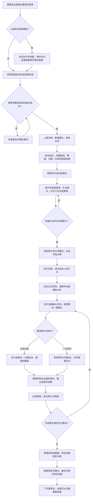

# 集成战略赛事网站使用交接文档

适用于接手网站的普通管理员、超级管理员及赛事裁判。以赛事功能提交 `0ba941f`、数据库结构版本 8 为基线。管理员登录后进入「后台管理」，日常办赛从仪表盘开始。文中的「赛道」在默认界面叫「肉鸽」，「本届」指唯一活跃的赛季。

## 一、管理员权限与后台入口

网站有普通管理员 `admin` 和超级管理员 `super_admin` 两类后台角色。超级管理员拥有普通管理员的后台操作权限，并可办理第二张表中的事项。裁判使用实际获分配的站内账号权限。两类管理员都可在右上角修改自己的密码，并从「账号与隐私」下载自己的资料副本。

### 两类管理员都能操作

| 后台入口 | 可以做的操作 | 使用条件与影响 |
| --- | --- | --- |
| 仪表盘（`/admin/dashboard`） | 查看用户、队伍和赛事统计、报名状态、赛季待办、最新队伍，以及正式场次、已判胜负和已结算数量。 | 按统计口径区分「已判胜负」和「已结算」。弃权可能已录入胜负但仍欠资料。 |
| 用户管理（`/admin/users`） | 按用户名或昵称搜索，查看角色、账号资料和队伍归属。把选手升为队长，或把队长降回选手。为选手、队长重置密码，删除无赛事或审计引用的选手、队长账号。 | 不能调整自己的角色。队长仍有本届队伍时，先处理队伍归属并满足删除条件。重置后把页面显示的临时密码私下交给本人，由本人登录修改。已匿名化或有引用的账号受保护。 |
| 选手资料、比赛详情 | 查看其他账号的用户名、注册时间等受限字段，以及队员参赛资料、双方赛况、留言和已被比赛引用的成绩截图（含旧截图）。 | 选手约赛、确认时间、留言、提交成绩或弃权仍取决于本人资格和该场状态。往届普通入口只读。 |
| 队伍管理（`/admin/teams`）和队伍详情 | 查本届队伍和成员。更新队伍照片、队伍宣言，以及本届成员的头像、赛道、分队、干员和参赛宣言。查看成员比赛累计、人工调整与合计。 | 新选的赛道必须已启用。匿名化账号的头像不能重新展示。已有比赛或积分调整引用的队伍不能删除。已知届次的历史队伍可在详情页只读核对。 |
| 队伍详情的积分账本 | 为本届成员填写目标总分，保存带原因的增减分记录。查看调整历史，按条填写原因并撤销。 | 系统把目标总分与原合计的差额作为调整记录。重算会保留仍有效的调整，撤销会立即重算。 |
| 赛事设置（`/admin/tournament-settings`） | 修改本届名称、报名与比赛的计划日期、队伍人数和允许未满员开赛设置，按需确认旧日期时区。通过「开启新赛季」选择继承项目，也可在符合条件时强制换季。 | 普通管理员和超管都能换季。存在未结算整场时，强制换季需要勾选并填写原因。任何换季都要求当次完整备份成功。该页可查看最近完整备份时间。 |
| 报名控制（`/admin/registration`）和报名列表（`/admin/registration-list`） | 手动打开或关闭报名，核对报名队伍、人员及赛道选择。 | 开放报名须有活跃赛季和至少一条启用赛道。计划日期用于提示，开赛操作不会自动关闭报名。 |
| 赛道管理（`/admin/roguelikes`） | 新增、编辑、启用、停用赛道，设置名称、标识、队内人数上限、排序、最低和最高难度、难度步长。删除可安全删除的赛道。 | 队员、比赛或快照引用过的赛道应停用，标识受保护。发现旧比赛缺少规则或倍率依据时，先核对后再变更配置。 |
| 规则管理（`/admin/rules`） | 新增、编辑、删除主规则或赛道规则，调整排序和发布状态。 | 开放报名前检查公开规则。往届使用该届快照，有未核对的历史规则时，编辑和删除会被拦截。 |
| 轮播管理（`/admin/carousel`） | 为本届添加、编辑或删除轮播条目，填写标题、素材路径和链接，上传图片或视频，排序并启用或停用。 | 本届有数据库条目时优先用这些条目。全部停用会隐藏轮播，无条目时回退到素材目录。删除条目后素材按留存规则管理。 |
| 仪表盘的赛事阶段控制 | 「开始比赛」从报名转到匹配，「执行匹配」成功后进入比赛进行中，「结束赛事」从进行中转到已结束。「恢复报名」可从其他阶段回到报名并打开报名。 | 开赛校验队伍人数及赛道，执行匹配和恢复报名也要求有启用赛道。恢复报名保留既有比赛，重新匹配前要核对日程，避免对同一批选手重复排赛。 |
| 日程管理（`/admin/schedule`）与分组抽取器（`/admin/draw`） | 按赛道选两名不同队伍的选手手动建赛，查看和筛选赛程，拖动改时间、拉伸改时长、拆成 2 至 4 段、一键确认整场及其分段、删除尚可调整的比赛。用分组抽取器重分组供现场展示。 | 正式日程写入从日程管理操作。抽取器的分组停留在浏览器。已有成绩或结果的整场及关联分段受保护，赛事结束后停止排赛。 |
| 比赛结果管理（`/admin/matches`）和单场成绩日志 | 筛选和查看本届正式整场。在比赛资料齐备后「确认结束并结算」，核对或修正双方原始分、难度和胜负。审核已结算结果，查看单场修改前后值、操作人和原因。 | 修改已结算成绩须填写原因。审核状态独立于成绩结算。待审核场次显示「审核通过」，后端也保留「驳回」能力，页面暂无对应按钮。 |
| 积分配置（`/admin/score-config`）和晋级管理（`/admin/advance`） | 修改晋级名额和队伍加成倍率，主动重算本届积分，核对排名、配置名额、实际晋级人数和场次统计。 | 重算使用本届已结算整场与有效调整。晋级线上的同分队伍全部晋级，实际人数可能超过名额。设为 `0` 时无晋级队伍。 |
| 数据工具（`/admin/data-tools`） | 下载本届赛事 Excel，包含报名信息、比赛结果、队伍积分榜和队员积分榜。 | 下载有审计，应按内部资料交接。普通管理员也能从换季操作触发系统前置备份，主动生成、查看批次列表及下载完整备份见超管权限。 |

维护时也会遇到由管理员权限保护的批量积分调整、分段间插入表演赛和快速表演赛等旧接口。当前后台日常调整以队员账本为入口，表演赛以独立专项安排为准。正式场次流程使用上表的页面操作。

### 超级管理员额外操作

| 后台入口 | 超管可以做的操作 | 使用条件与影响 |
| --- | --- | --- |
| 用户管理 | 将选手或队长升为普通管理员，将其他普通管理员降为选手。重置其他普通管理员和其他超管的密码。 | 本人密码走「修改密码」。后台没有创建或降级超级管理员的按钮。新实例在首次显式初始化时，按部署配置创建超管账号。 |
| 用户管理 → 处理隐私申请 | 按已核验的申请编号或办理依据导出他人的个人数据副本，或匿名化其他非超管账号。后端允许超管删除符合无引用条件的其他普通管理员账号，当前页面没有对管理员提供删除按钮。 | 匿名化会停用登录与现有会话，停止展示原头像，使用化名保留用户 ID、队伍、比赛、成绩与审计。本人和超级管理员账号不能从该入口匿名化或删除。 |
| 数据工具 → 完整备份 | 立即生成数据库和素材备份，查看最近成功时间和完整批次，下载同批次的数据库文件、素材包和 `manifest.json`。 | 下载时重新校验同批次文件。默认保留最近五份完整备份。恢复演练在隔离数据库和目录通过运维命令执行，网页用于下载及登记演练结果。 |
| 数据工具 → 手动清理 | 预览、取消或二次确认清理，范围含孤立头像、队伍照、上传轮播素材、符合规则的孤立截图，以及早于保留天数的系统日志。 | 截图可按「保留最近 N 届」或「已审核通过的场次」筛选。有效预览绑定操作者，15 分钟内确认。运行中仍有引用的素材受保护，清理结果有审计。 |
| 数据工具 → 成绩日志 | 下载全库成绩日志 `ScoreLog` JSON。 | 单场日志两类管理员都能查看，全量导出限超管。成绩日志永久保留。 |
| 数据工具 → 素材盘点 | 查看引用缺失、孤立、内容变化和重复的素材，下载 JSON 清单。 | 素材清单可用于迁移前后按路径和 SHA-256 核对，清理另走手动预览及确认。 |
| 数据工具 → 赛事发布包 | 从当届配置生成并校验草稿，复制历史版、导入 JSON、清除草稿、逐版发布，下载已发布版本的 JSON 或 Markdown。对合格的新届执行「备份并应用到本届」。 | 应用目标须处于报名阶段、报名关闭、且没有队伍或比赛。确认规则、赛道、素材校验值和部署设置后应用。发布包用于搬运配置，全量数据与素材恢复使用完整备份。 |
| 数据工具 → 每届运营交接包 | 按届查看和下载 Markdown 或 JSON，维护裁判操作、已知问题、临时配置和争议工单说明，登记恢复演练批次及结果，下载已核对的往届 Excel。 | 交接记录有版本和审计。保存遇到他人更新时先刷新。演练登记须选该届的完整备份，并填写结果和凭证。往届 Excel 使用该届快照和晋级名额。 |
| 往届专项纠错（从往届队伍后台详情进入） | 按历史快照纠正往届整场的原始分、难度和适用结果，为可核对的未结算整场补齐并确认结算，重算该届积分。 | 必须填写原因并保留前后值。历史归属或规则基准缺失时，由运维先出 `data-report`，超管核验原始凭证后走 `reconcile`。普通队伍、赛程和积分调整入口仍为只读。 |

账号运维按页面展示的角色操作办理。当前版本的通用队长、选手角色变更校验对普通管理员目标的保护与页面展示存在差异，管理员角色的授予和撤销按超管专用操作交接。网站角色与服务器运维账号分别授权，`prepare` 和隔离恢复由掌握实例配置的运维执行。 [部署与初始化](../README.md#快速启动) · [旧数据核对与备份恢复](P0实施与验证.md)

## 二、从开启新赛季到完赛的流程图

## 三、逐步操作

### 1. 开启新赛季并检查待办

1. 进入「后台管理 → 赛事设置 → 开启新赛季」。先确认当前届次和未结算整场清单。按常规流程先补交、结算后换季。必须立即切换时，勾选「强制换季」并说明原因。未结算场次会按原状态保留在往届，普通提交冻结。
2. 填写新赛季名称，可勾选继承报名时间、比赛时间、晋级数量、轮播，并确认沿用队伍人数和未满员开赛设置。未继承的计划日期留空、晋级数量归零。队伍人数、未满员设置是全局配置，未勾选也会保留当前值。队伍倍率默认沿用上届，规则与赛道沿用全局配置，旧届保留快照。
3. 点击「开启新赛季」并确认。系统先备份数据库和素材，备份失败时保留原活跃赛季。成功后上届归档，账号和上届赛事记录保留，选手参赛进度与可用时间重置，上届待处理邀请和申请清理，已处理记录可查询。新届的报名开关初始关闭。
4. 回到仪表盘检查换季待办。重新核对名称、队制、已发布规则、启用赛道和难度、本届倍率和晋级名额、轮播、报名及比赛日期。继承日期原样复制，按页面显示的赛事时区改成当届日期。计划时间用于提醒，开关和阶段需由管理员操作。
5. 如需从发布包复用规则和素材，应由超管在**报名关闭且尚无队伍或比赛**时导入、校验和应用，再核对一次待办。新建实例若已经初始化首届，可直接核对首届配置。 [复用指南](复用指南.md)

### 2. 开放报名并核对参赛资格

1. 在「报名控制」选「开放」并保存。先启用至少一条赛道。已有账号直接登录，新选手注册后即可登录。
2. 管理员按分工在「用户管理」把队长人选升为队长。队长从队长中心建队，系统将队长本人加入队伍。队长可以发邀请，选手也可以在选手中心申请入队，由队长处理。队长可按队伍配置为成员分配位置。
3. 队长和选手都要为自己的成员记录选一条已启用赛道，按赛事要求填写分队、干员和参赛宣言。可填写可用时间，供双方和组织者排期参考。站内自动匹配按赛道和不同队伍配对。
4. 管理员在报名列表或队伍管理核对报名，人员不足而且未允许未满员开赛时，队伍须先补人。开赛会检查本届队伍人数和成员的启用赛道。申请、邀请、建队和选赛道等报名动作办妥后，再按运营计划手动关闭报名。 [阶段准入矩阵](P1-4实施与验证.md#阶段准入)

### 3. 开赛、匹配和确认日程

1. 仪表盘点「开始比赛」进入匹配阶段，再点「执行匹配」。成功后阶段进入「比赛进行中」。匹配无法生成有效对阵时，核对选手数、各赛道和队伍分布后再试。轮空的选手没有正式对阵记录、胜负或积分。
2. 到「日程管理」核对匹配生成的整场，可选同赛道且来自不同本届队伍的两人手动建赛。手动建赛会按实例配置的时段生成日程段。需要拆分已有日程时，在允许调整且已安排时间的场次上调整或分段。分段只记录日程，成绩按同一整场处理。
3. 选手从「我的比赛」打开详情，一方填写双方议定的比赛时间，另一方确认。修改时间会重新要求确认。已经协调好的场次可由管理员在日程管理一键确认。双方以网站显示的赛事时区和最终日程为准。 [复用指南的排赛与抽签](复用指南.md#64-排赛与抽签工具)

### 4. 完赛、提交和结算每一场

1. 比赛确认后，双方在「我的比赛 → 比赛详情 → 提交成绩」各提交一次整场成绩。选择实际难度，手填整数原始分，`0` 分有效。页面要求上传 1 至 3 张 PNG、JPEG 或 WebP 截图，每张最多 4 MiB。把分段的证据汇总到整场提交，并在同一场的留言中补充必要说明。
2. 有选手弃权时，由参赛者在比赛详情执行「弃权比赛」。系统立即记对手获胜，弃权方已有成绩照存，从未提交则记录该方 `0` 分。另一方可补交，双方资料齐备后由管理员确认结算。
3. 管理员打开「比赛结果管理」，找到对应整场，核对双方截图、原始分和难度，点「确认结束并结算」。正常场次选择 A 获胜、B 获胜或平局。弃权结果由系统沿用该场记录。该场结算后才计入积分，并留下成绩日志。
4. 结算后可点「审核通过」。审核驳回保留已经记下的积分与胜负。确需修正已结算结果时，从整场「修改」填写原因，保存后按原规则和倍率快照重算。用于独立加减分的事项走队伍详情的积分账本。 [正式积分、场次与晋级联验](P1-5与P1-6联验.md)

个人积分按整场原始分乘该选手的难度倍率，再向零取整。队员的比赛累计加有效人工调整得到队员总分，全队队员总分之和再乘本届队伍倍率。并列名次占位跳号，例如 `1、1、3`，晋级线同分全部晋级。

### 5. 结束赛事并交接

1. 对照后台正式场次、已结算数量、未结算清单、审核状态、调整账本和「晋级管理」。从「数据工具」导出本届 Excel，对比结果页、排名和实际晋级名单。发现差异时先核对整场状态、历史倍率和调整记录。
2. 操作员在比赛进行中点「结束赛事」。结束后停止排新赛程，已安排且状态允许的对阵仍可提交、弃权、补交、结算和审核。「结束赛事」后本届仍是活跃赛季，到下一次开启新赛季时才转入往届归档。
3. 超管从「赛事发布包」保存最终配置版本，从「数据工具」下载同批次的数据库、素材与校验清单。在隔离环境以匹配版本恢复并核对，再从「每届运营交接包」登记结果和凭证。
4. 在交接包中记下本届及计划下一届的交接负责人、配置发布版本、备份批次、恢复记录、结果导出、未结算场次、人工调整和历史待核对项。保存并下载交接包，交给对应权限的接手人。 [交接包操作说明](复用指南.md#610-每届运营交接包) · [备份与恢复](P0实施与验证.md#备份与恢复)
